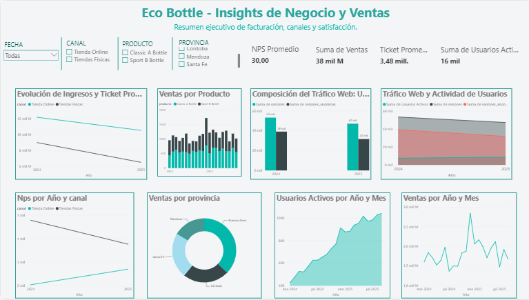

# Eco Bottle — Mini-Ecosistema de Datos Comercial (OLTP a DW)

Proyecto final desarrollado para la materia **Introducción al Marketing Online y los Negocios Digitales** de la Universidad Austral. El proyecto implementa un pipeline de datos completo (ETL/ELT con DuckDB y Python), el modelado dimensional bajo la metodología Kimball y la construcción de un tablero ejecutivo interactivo en Power BI para monitorear las métricas comerciales de la empresa **EcoBottle AR** (ventas online y offline, 4 tiendas físicas, tráfico web y satisfacción NPS).

---
## 📑 Índice

- [Estructura del Repositorio](#-estructura-del-repositorio)
- [Instrucciones de Ejecución](#-instrucciones-de-ejecución)
- [Supuestos de Negocio](#-supuestos-de-negocio)
- [Diccionario de Datos (Modelo Estrella - Kimball)](#-diccionario-de-datos-modelo-estrella---kimball)
  - [1. Tablas de Dimensiones (`dim_`)](#1-tablas-de-dimensiones-dim_)
  - [2. Tablas de Hechos (`fact_`)](#2-tablas-de-hechos-fact_)
  - [3. Data Marts Pre-calculados (`mart_`)](#3-data-marts-pre-calculados-mart_)
- [Consultas Clave (SQL)](#-consultas-clave-sql)
  - [1. Ventas Totales ($M) y Ticket Promedio ($K) por Canal y Mes](#1-ventas-totales-m-y-ticket-promedio-k-por-canal-y-mes)
  - [2. Cálculo Mensual del Net Promoter Score (NPS) por Canal](#2-cálculo-mensual-del-net-promoter-score-nps-por-canal)
  - [3. Ranking Mensual de Productos por Ventas](#3-ranking-mensual-de-productos-por-ventas)
- [Tablero Ejecutivo y Especificaciones de Visualización (Power BI)](#-tablero-ejecutivo-y-especificaciones-de-visualización-power-bi)
  - [1. Filtros y Segmentaciones (Slicers)](#1-filtros-y-segmentaciones-slicers)
  - [2. Tarjetas de Indicadores Clave (KPI Cards)](#2-tarjetas-de-indicadores-clave-kpi-cards)
  - [3. Especificaciones de Gráficos y Visualizaciones](#3-especificaciones-de-gráficos-y-visualizaciones)
---

## 📁 Estructura del Repositorio

```text
raw/               Datos de origen (archivos CSV transaccionales del sistema OLTP)
sql/               Scripts DDL y DML de transformación en SQL (modelo estrella y data marts)
dw/                Data Warehouse resultante (tablas procesadas en formato CSV para Power BI)
assets/            Recursos visuales y diagrama entidad-relación de origen (DER)
venv/              Entorno virtual de Python con las dependencias del proyecto
requirements.txt   Lista de librerías requeridas (DuckDB)
run_sql.py         Script Python de automatización para construir el Data Warehouse
warehouse.duckdb   Base de datos analítica local creada al ejecutar el pipeline
README.md          Documentación técnica del proyecto y diccionario de datos
```
---

## 🚀 Instrucciones de Ejecución

Para levantar el pipeline y generar la base de datos analítica local (`warehouse.duckdb`) junto con los data marts en CSV, sigue estos pasos:

1. **Clona el repositorio** y abre la terminal en la carpeta raíz del proyecto.
2. **Activa el entorno virtual** de Python:
   - En Windows (PowerShell): `.\venv\Scripts\Activate`
   - En Mac/Linux: `source venv/bin/activate`
3. **Verifica las dependencias** requeridas ejecutando:

   `pip install -r requirements.txt`
4. **Ejecuta el script de automatización del pipeline ETL/ELT**

  `python run_sql.py`
5. **Conecta Power BI a los archivos procesados en la carpeta `dw/` o directamente a la base `warehouse.duckdb` para visualizar el tablero ejecutivo.**

---

## 💡 Supuestos de Negocio

* **Ventas y Facturación:** Solo se consideran válidas para el cálculo de ingresos netos, unidades vendidas y ticket promedio aquellas órdenes cuyo estado sea `PAID` (Pagada) o `FULFILLED` (Entregada/Completada). Se excluyen órdenes en estado `CREATED`, `CANCELLED` o `REFUNDED`.
* **Usuarios Activos:** Se computan desde `fact_web_session`. Las sesiones con `customer_id` nulo corresponden a visitantes anónimos, mientras que la métrica de usuarios activos mensuales se calcula mediante `COUNT(DISTINCT customer_id)`.
* **Net Promoter Score (NPS):** Las encuestas enviadas se asocian al canal de venta (`ONLINE` u `OFFLINE`). Se consideran *Promotores* a las calificaciones de 9 a 10 y *Detractores* a las de 0 a 6. El score se determina mediante la fórmula:
  $$\text{NPS} = (\% \text{ Promotores} - \% \text{ Detractores}) \times 100$$
* **Geografía:** Las transacciones se consolidan por provincia según la dirección de envío (`shipping_address_id`) vinculada a la dimensión de localización (`dim_location`).

---

## 📖 Diccionario de Datos (Modelo Estrella - Kimball)

El Data Warehouse `warehouse.duckdb` está estructurado en un modelo dimensional estrella que separa claramente atributos descriptivos y métricas de negocio:

```mermaid
erDiagram
    dim_carrier ||--o{ fact_shipment : "carrier_key"
    dim_channel ||--o{ fact_nps : "channel_id"
    dim_channel ||--o{ fact_payment : "channel_id"
    dim_channel ||--o{ fact_sales : "channel_id"
    dim_channel ||--o{ fact_sales_item : "channel_id"
    dim_channel ||--o{ fact_shipment : "channel_id"
    dim_customer ||--o{ fact_nps : "customer_id"
    dim_customer ||--o{ fact_payment : "customer_id"
    dim_customer ||--o{ fact_sales : "customer_id"
    dim_customer ||--o{ fact_sales_item : "customer_id"
    dim_customer ||--o{ fact_shipment : "customer_id"
    dim_customer ||--o{ fact_web_session : "customer_id"
    dim_date ||--o{ fact_nps : "date_id"
    dim_date ||--o{ fact_payment : "date_id"
    dim_date ||--o{ fact_sales : "date_id"
    dim_date ||--o{ fact_sales_item : "date_id"
    dim_date ||--o{ fact_shipment : "delivered_date_id"
    dim_date ||--o{ fact_shipment : "shipped_date_id"
    dim_date ||--o{ fact_web_session : "date_id"
    dim_device ||--o{ fact_web_session : "device_key"
    dim_location ||--o{ fact_sales : "location_id"
    dim_location ||--o{ fact_sales_item : "location_id"
    dim_payment_method ||--o{ fact_payment : "payment_method_key"
    dim_product ||--o{ fact_sales_item : "product_key"
    dim_store ||--o{ fact_sales : "store_id"
    dim_store ||--o{ fact_sales_item : "store_id"
    dim_traffic_source ||--o{ fact_web_session : "traffic_source_key"
    fact_sales ||--o{ fact_payment : "order_id"
    fact_sales ||--o{ fact_sales_item : "order_id"
    fact_sales ||--o{ fact_shipment : "order_id"
    dim_carrier {
        INTEGER carrier_key PK
        VARCHAR carrier
    }
    dim_channel {
        INTEGER channel_id PK
        VARCHAR code
        VARCHAR name
    }
    dim_customer {
        INTEGER customer_id PK
        VARCHAR email
        VARCHAR first_name
        VARCHAR last_name
        VARCHAR phone
        VARCHAR status
        TIMESTAMP created_at
    }
    dim_date {
        INTEGER date_id PK
        DATE full_date
        INTEGER day
        INTEGER month
        INTEGER year
        INTEGER quarter
    }
    dim_device {
        INTEGER device_key PK
        VARCHAR device
    }
    dim_location {
        INTEGER location_id PK
        VARCHAR address_line
        VARCHAR city
        VARCHAR province_name
        VARCHAR province_code
        VARCHAR postal_code
        VARCHAR country_code
    }
    dim_mes {
        DATE mes PK
        INTEGER anio
        INTEGER nro_mes
    }
    dim_payment_method {
        INTEGER payment_method_key PK
        VARCHAR method
    }
    dim_product {
        INTEGER product_key PK
        INTEGER product_id
        VARCHAR sku
        VARCHAR name
        VARCHAR category
        VARCHAR family
        DECIMAL list_price
    }
    dim_store {
        INTEGER store_id PK
        VARCHAR store_name
        INTEGER address_id
        VARCHAR city
        VARCHAR province_name
    }
    dim_traffic_source {
        INTEGER traffic_source_key PK
        VARCHAR source
    }
    fact_nps {
        BIGINT nps_id PK
        INTEGER date_id FK
        INTEGER customer_id FK
        INTEGER channel_id FK
        SMALLINT score
        VARCHAR comment
        TIMESTAMP responded_at
    }
    fact_payment {
        BIGINT payment_id PK
        BIGINT order_id FK
        INTEGER date_id FK
        INTEGER customer_id FK
        INTEGER channel_id FK
        INTEGER payment_method_key FK
        VARCHAR status
        DECIMAL amount
        TIMESTAMP paid_at
        VARCHAR transaction_ref
    }
    fact_sales {
        BIGINT order_id PK
        INTEGER date_id FK
        INTEGER customer_id FK
        INTEGER channel_id FK
        INTEGER location_id FK
        INTEGER store_id FK
        TIMESTAMP order_date
        VARCHAR status
        VARCHAR currency_code
        DECIMAL subtotal
        DECIMAL tax_amount
        DECIMAL shipping_fee
        DECIMAL total_amount
    }
    fact_sales_item {
        BIGINT order_item_id PK
        BIGINT order_id FK
        INTEGER date_id FK
        INTEGER customer_id FK
        INTEGER channel_id FK
        INTEGER location_id FK
        INTEGER store_id FK
        INTEGER product_key FK
        VARCHAR status
        INTEGER quantity
        DECIMAL unit_price
        DECIMAL discount_amount
        DECIMAL line_total
    }
    fact_shipment {
        BIGINT shipment_id PK
        BIGINT order_id FK
        INTEGER customer_id FK
        INTEGER channel_id FK
        INTEGER carrier_key FK
        INTEGER shipped_date_id FK
        INTEGER delivered_date_id FK
        VARCHAR tracking_number
        VARCHAR status
        TIMESTAMP shipped_at
        TIMESTAMP delivered_at
        INTEGER delivery_days
    }
    fact_web_session {
        BIGINT session_id PK
        INTEGER date_id FK
        INTEGER customer_id FK
        INTEGER traffic_source_key FK
        INTEGER device_key FK
        TIMESTAMP started_at
        TIMESTAMP ended_at
        INTEGER duration_minutes
    }
    mart_nps_mensual {
        DATE mes PK
        VARCHAR canal PK
        INTEGER respuestas
        INTEGER promotores
        INTEGER detractores
        DECIMAL nps
    }
    mart_producto_mensual {
        DATE mes PK
        VARCHAR producto PK
        DECIMAL ventas
        INTEGER unidades
        INTEGER ranking
    }
    mart_usuarios_mensual {
        DATE mes PK
        INTEGER usuarios_activos
        INTEGER sesiones
        INTEGER sesiones_anonimas
    }
    mart_ventas_mensual {
        DATE mes PK
        VARCHAR canal PK
        VARCHAR provincia PK
        DECIMAL ventas
        INTEGER pedidos
        DECIMAL ticket_promedio
    }
```




### 1. Tablas de Dimensiones (`dim_`)
* **`dim_date`**: Dimensión de tiempo con grano diario (claves numéricas `YYYYMMDD`, día, mes, trimestre, año).
* **`dim_channel`**: Canales de comercialización (`ONLINE`, `OFFLINE`).
* **`dim_customer`**: Maestro de clientes con datos de contacto y estado de la cuenta.
* **`dim_product`**: Maestro de productos desnormalizado con su categoría y familia de artículos (*Classic A* y *Sport B*).
* **`dim_location`**: Direcciones normalizadas con localidad, provincia y código postal.
* **`dim_store`**: Puntos de venta físicos (sucursales Buenos Aires, Córdoba, Santa Fe y Mendoza).
* **`dim_traffic_source`** / **`dim_device`**: Atributos analíticos de navegación web.
* **`dim_payment_method`** / **`dim_carrier`**: Dimensiones de soporte para medios de pago y transportistas de envío.

### 2. Tablas de Hechos (`fact_`)
* **`fact_sales`**: Cabecera de pedidos (`order_id`). Registra importes de subtotal, impuestos, envío y total general.
* **`fact_sales_item`**: Detalle de líneas de pedido (`order_item_id`). Registra producto, cantidad, precio unitario y total por línea.
* **`fact_nps`**: Respuestas a la encuesta de satisfacción por cliente, canal y puntaje obtenido.
* **`fact_web_session`**: Registro de sesiones de navegación en el sitio web con sello de tiempo y duración.
* **`fact_payment`** / **`fact_shipment`**: Transacciones de cobro y trazabilidad logística de entregas.

### 3. Data Marts Pre-calculados (`mart_`)
Para optimizar el rendimiento y la carga directa en Power BI, se generan tablas agregadas mensuales en `04_data_marts.sql`:
* `mart_ventas_mensual`, `mart_producto_mensual`, `mart_nps_mensual` y `mart_usuarios_mensual`.

---

## 🔍 Consultas Clave (SQL)

Consultas principales utilizadas para validar las métricas requeridas por el negocio:

### 1. Ventas Totales ($M) y Ticket Promedio ($K) por Canal y Mes
```sql
SELECT 
    d.year,
    d.month,
    c.name AS channel_name,
    SUM(f.total_amount) AS total_ventas,
    COUNT(f.order_id) AS total_pedidos,
    AVG(f.total_amount) AS ticket_promedio
FROM fact_sales f
JOIN dim_date d ON f.date_id = d.date_id
JOIN dim_channel c ON f.channel_id = c.channel_id
WHERE f.status IN ('PAID', 'FULFILLED')
GROUP BY d.year, d.month, c.name
ORDER BY d.year, d.month, c.name;

2. Cálculo Mensual del Net Promoter Score (NPS) por Canal
WITH nps_categorized AS (
    SELECT 
        d.year,
        d.month,
        c.name AS channel_name,
        CASE WHEN n.score >= 9 THEN 1 ELSE 0 END AS is_promoter,
        CASE WHEN n.score <= 6 THEN 1 ELSE 0 END AS is_detractor
    FROM fact_nps n
    JOIN dim_date d ON n.date_id = d.date_id
    JOIN dim_channel c ON n.channel_id = c.channel_id
)
SELECT 
    year,
    month,
    channel_name,
    COUNT(*) AS total_respuestas,
    ROUND(
        (SUM(is_promoter::FLOAT) / COUNT(*) - SUM(is_detractor::FLOAT) / COUNT(*)) * 100, 
        2
    ) AS nps_score
FROM nps_categorized
GROUP BY year, month, channel_name
ORDER BY year, month, channel_name;

3. Ranking Mensual De Productos por Ventas
SELECT 
    d.year,
    d.month,
    p.name AS product_name,
    SUM(i.quantity) AS total_unidades_vendidas,
    SUM(i.line_total) AS total_ingresos
FROM fact_sales_item i
JOIN fact_sales f ON i.order_id = f.order_id
JOIN dim_product p ON i.product_key = p.product_key
JOIN dim_date d ON f.date_id = d.date_id
WHERE f.status IN ('PAID', 'FULFILLED')
GROUP BY d.year, d.month, p.name
ORDER BY d.year, d.month, total_ingresos DESC;
```
---

## 📈 Tablero Ejecutivo y Especificaciones de Visualización (Power BI)

El reporte interactivo se alimenta exclusivamente de las **4 tablas de Data Marts pre-calculadas en DuckDB** (`mart_ventas_mensual`, `mart_producto_mensual`, `mart_nps_mensual`, `mart_usuarios_mensual`), logrando un modelo analítico optimizado y de alta performance sin necesidad de fórmulas DAX complejas.



### 🎛️ 1. Filtros y Segmentaciones (Slicers)
Permiten realizar un filtrado transversal en tiempo real sobre todo el tablero:
- **FECHA / MES:** Filtra la temporalidad del negocio utilizando el campo `mes` proveniente de las tablas mart.
- **CANAL:** Segmenta el análisis entre *Tienda Online* y *Tiendas Físicas* mediante la variable `canal` 
- **PRODUCTO:** Permite seleccionar las familias de artículos (*Classic A Bottle*, *Sport B Bottle*) utilizando el campo `producto` 
- **PROVINCIA:** Filtra geográficamente por las distintas sucursales y regiones (*Córdoba*, *Mendoza*, *Santa Fe*, *Buenos Aires*) usando el campo `provincia`

### 🧮 2. Tarjetas de Indicadores Clave (KPI Cards)
Ubicadas en la barra superior del reporte para una lectura ejecutiva inmediata:
- **NPS Promedio:** Muestra el puntaje global de satisfacción del cliente calculado en base a `mart_nps_mensual`.
- **Suma de Ventas:** Ingresos netos totales acumulados mediante la variable `Ventas` (`mart_ventas_mensual`).
- **Ticket Promedio:** Relación de ingresos por pedido utilizando el campo `ticket_promedio` (`mart_ventas_mensual`, `mart_nps_mensual`).
- **Suma de Usuarios Activos:** Volumen total de alcance e interacción de usuarios extraído del campo `Usuarios Activos` (`mart_usuarios_mensual`).

### 📊 3. Especificaciones de Gráficos y Visualizaciones
Cada componente visual se conecta de forma directa con los atributos de los data marts:
- **Evolución de Ingresos y Ticket Promedio (Gráfico de Líneas):** Contrasta el comportamiento temporal de la facturación y el ticket promedio discriminado por `canal` (`mart_ventas_mensual`).
- **Ventas por Producto (Gráfico de Columnas):** Compara el volumen de ingresos (`ventas`), unidades y el `ranking` comercial de cada artículo (`mart_producto_mensual`).
- **Composición del Tráfico Web (Gráfico de Columnas Apiladas):** Detalla la proporción del tráfico diferenciando las `sesiones` totales de las `sesiones_anonimas` (`mart_usuarios_mensual`).
- **Tráfico Web y Actividad de Usuarios (Gráfico de Áreas):** Visualiza de forma conjunta la evolución de `Usuarios Activos` frente al volumen total de sesiones (`mart_usuarios_mensual`).
- **Nps por Año y Canal (Gráfico de Líneas):** Evalúa la evolución temporal del índice de satisfacción utilizando la métrica `Nps` y el campo `canal` (`mart_nps_mensual`).
- **Ventas por Provincia (Gráfico de Anillo / Donut):** Distribuye porcentualmente la facturación total (`Ventas`) según la `provincia` operativa (`mart_ventas_mensual`).
- **Usuarios Activos por Año y Mes (Gráfico de Líneas):** Muestra la tendencia de crecimiento mensual de `Usuarios Activos` (`mart_usuarios_mensual`).
- **Ventas por Año y Mes (Gráfico de Líneas):** Muestra el comportamiento estacional y mensual de la facturación total (`Ventas` de `mart_ventas_mensual`).

---

* **Autoría:** Bianca Rossi — Universidad Austral
* **Contacto:** brossi@mail.austral.edu.ar


